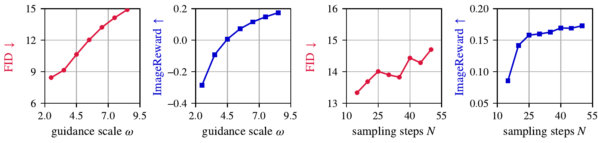
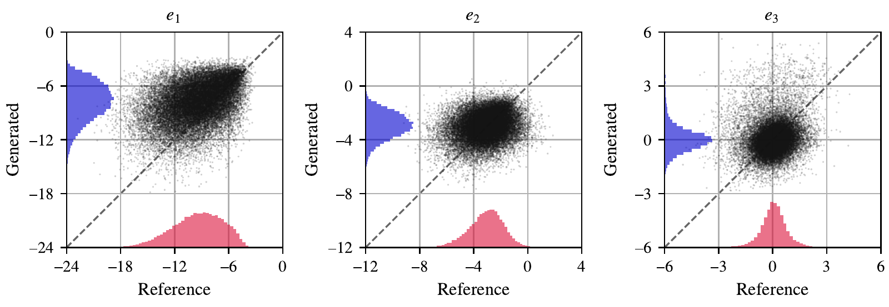

# What Does Fréchet Distance Measure? A Directional Decomposition

[](https://arxiv.org/abs/2610.05518)
[](https://arxiv.org/pdf/2610.05518)
[](LICENSE)

[Yunghee Lee](https://yhl.ee) and [Jaeyeon Kim](https://jaeyeonkim01.github.io/)

## News

- **Oct 2026**: The paper is on [arXiv](https://arxiv.org/abs/2610.05518).

## Overview



The Fréchet distance is the standard way to evaluate generative models across domains: FID for images, FVD for videos, and Protein FID for protein structures.
It reduces the gap between the generated and reference distributions to one number, which can hide what drives the comparison.
On COCO, for example, raising the guidance scale or the number of diffusion sampling steps improves ImageReward but worsens FID (above).

We introduce the **directional Fréchet distance**: the expected squared projection of the optimal transport displacement onto a given direction.
It splits the Fréchet distance exactly over any orthonormal basis, so the distance can be attributed to directions in feature space and named by the concepts they encode.



Across three case studies, a few interpretable directions account for much of the distance:

- **Images (FID)**: two-thirds of the FID increase from more sampling steps on COCO lies along a single direction, associated with composition simplicity through CLIP concept bridges.
- **Videos (FVD)**: the flicker band carries less of the distance than the appearance band with I3D features, but more with VideoMAE-v2 features.
- **Proteins (Protein FID)**: a single direction associated with structural regularity accounts for most of the gap, while the alpha-versus-beta direction accounts for little.

## Quick start

The directional Fréchet distance is in [`src/core/features/directions/ot.py`](src/core/features/directions/ot.py) and needs only PyTorch; import it after `pip install -e .`, or with `src/` on `PYTHONPATH`.

```python
import torch
from core.features.directions.ot import displacement

ref = torch.randn(10_000, 512, dtype=torch.float64)  # reference features [N, D]
gen = torch.randn(10_000, 512, dtype=torch.float64)  # generated features [N, D]

d = displacement(ref, gen)  # displacement second-moment matrix M, with tr M = FD
d.fid()                     # the Fréchet distance itself
axes = d.eigen_axes()       # eigenvectors of M, largest first
d.fid_w(axes[:3])           # directional FD along the top three directions
d.fid_w(w)                  # directional FD along any direction w, e.g. a concept direction
```

## Environment

The Docker image provides CUDA 12.8, the Python environment, a separate La-Proteina environment, and the MongoDB instance that [Sacred](https://github.com/IDSIA/sacred) logs every run to.

```bash
docker build -t directional-fd .
docker run -d --gpus=all --shm-size=8g -v $(pwd):/workspace directional-fd
docker exec -it <container> bash
cd /workspace
source /ddiff-base/py3.10-torch2.9.0/.venv/bin/activate
pip install -e . --no-deps --no-build-isolation
```

Run every command from the repository root.
Datasets and model weights download on first use.

## Reproducing the paper

### 1. Generate the sets and their features (GPU)

Each run generates a set with `experiments/generate.py`, computes one metric, and caches the reference and generated features next to the samples in `samples/`.

```bash
# Images: SD1.5 + DDIM at 15, 20, ..., 50 steps on six references, scored with
# FID, FD over CLIP and DINOv2 features, and ImageReward
python scripts/iclr27/image_sweep.py

# Video: ModelScope zero-shot on the UCF-101 class names, FVD over I3D and VideoMAE-v2
accelerate launch experiments/generate.py with configs/modelscope.yaml
accelerate launch experiments/generate.py with configs/modelscope.yaml metric_name=CDFVD

# Proteins: La-Proteina at 100 to 600 steps, 467 structures each, Protein FID
python scripts/iclr27/protein_sweep.py
```

Generate each protein set in one uninterrupted run on a single GPU.
La-Proteina draws a whole set from one seed and spreads it over five chain lengths, while the pipeline resumes a partial set by generating only its missing structures, so a resumed or multi-GPU run gives different structures than a single full run.
Delete a partial `samples/iclr27/laproteina_steps*_467/` directory and rerun it rather than resuming.

### 2. Reproduce the tables and figures

The analysis reads the cached features.
Once they exist it runs on CPU with `ACCELERATE_USE_CPU=true`; figures are written to `scripts/iclr27/figs/`.
The first run of `interpret_fvd.py` embeds the distorted UCF-101 probe sets, and the first run of `protein_directions.py` embeds the CATH S40 domains (about 45 minutes on one GPU).

| Paper | Command |
| --- | --- |
| Figure 1 | `python scripts/iclr27/reversal_sweep.py` |
| Table 1, Figure 2, Table 4, Appendix D | `python scripts/iclr27/interpret_directions.py --plot` |
| DINOv2 check (Section 4.1.1) | `python scripts/iclr27/interpret_directions.py --extractor dinov2` |
| Figure 3, Section 4.1.2, Appendix D slope | `python scripts/iclr27/reversal_shares.py --reference COCO30K` |
| Figure 4, Appendix E | `python scripts/iclr27/reversal_cumulative.py` and `python scripts/iclr27/reversal_basis.py` |
| Tables 2, 5, 6 | `python scripts/iclr27/interpret_fvd.py --generated samples/modelscope` |
| Table 3, Section 4.3, Table 7 (PCA-32 rows), Appendix G | `python scripts/iclr27/protein_directions.py` |
| Table 7 (raw rows) | `python scripts/iclr27/protein_directions.py --space raw` |

## Repository structure

```
configs/                    # YAML configs for experiments/generate.py
experiments/generate.py     # Sacred entry point: generate a set and compute a metric
scripts/iclr27/             # the sweeps and the analysis behind each table and figure
src/core/
  data/                     # image, video, and protein datasets
  models/, solvers/         # SD1.5, ModelScope, and La-Proteina with their samplers
  features/
    extractors.py           # Inception, CLIP, DINOv2, I3D, VideoMAE-v2, ESM3
    metrics.py              # FID, FD over CLIP and DINOv2, FVD, CD-FVD, Protein FID, ImageReward, ...
    directions/             # directional Fréchet distance and direction naming
  vendor/                   # vendored CMMD, Inception labels, and protfid
```

## Acknowledgements

The codebase grows out of [Tortoise and Hare Guidance](https://github.com/yhlee-add/THG).
It vendors [protfid](https://github.com/ffaltings/protfid) for Protein FID, and code from [CMMD](https://github.com/google-research/google-research/tree/master/cmmd) and the TensorFlow Inception labels, each with its provenance in [`src/core/vendor/`](src/core/vendor/).
We thank the authors of [clean-fid](https://github.com/GaParmar/clean-fid), [cd-fvd](https://github.com/songweige/content-debiased-fvd), [ImageReward](https://github.com/THUDM/ImageReward), and [La-Proteina](https://github.com/NVIDIA-Digital-Bio/la-proteina) for releasing their code.

## Citation

```bibtex
@article{lee2026directional,
  title={What Does Fr{\'e}chet Distance Measure? A Directional Decomposition},
  author={Lee, Yunghee and Kim, Jaeyeon},
  journal={arXiv preprint arXiv:2610.05518},
  year={2026}
}
```

## License

This work is licensed under [CC BY 4.0](https://creativecommons.org/licenses/by/4.0/) ([LICENSE](LICENSE)), the same license as the paper; the vendored code in `src/core/vendor/` keeps its own license.
